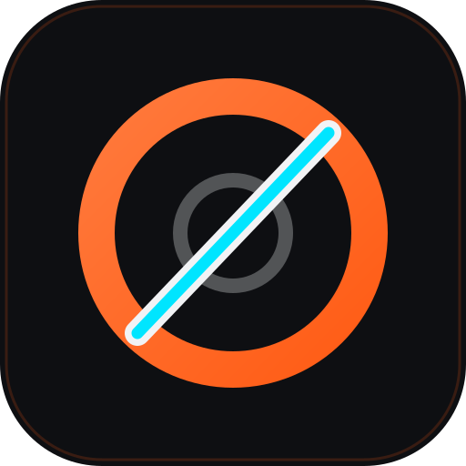

# kavo

Things I build and run, out of Brisbane.

<table>
  <tr>
    <td width="88" align="center"></td>
    <td>
      <b><a href="https://outlap.studio/">Outlap Studio</a></b> 
      A web studio for marketing sites, web apps and online stores. Clients own what we build outright. 
      <a href="https://outlap.studio/">outlap.studio</a> · <a href="https://www.linkedin.com/company/outlap-studio">LinkedIn</a> · <a href="https://www.instagram.com/outlapstudio.au/">Instagram</a> · <a href="https://www.facebook.com/outlap.studio">Facebook</a>
    </td>
  </tr>
  <tr>
    <td width="88" align="center"></td>
    <td>
      <b><a href="https://www.bulletracing.team/">Bullet Racing Engineering</a></b> 
      Custom SINUMERIK 808D screen packages with probing suites, plus machined WP suspension and Honda RS125/RS250 parts. Built in Queensland and shipped worldwide. 
      <a href="https://www.bulletracing.team/">bulletracing.team</a> · <a href="https://www.instagram.com/teambulletracing/">Instagram</a> · <a href="https://www.youtube.com/@bulletracingMCE">YouTube</a> · <a href="https://www.facebook.com/profile.php?id=100085931140598">Facebook</a>
    </td>
  </tr>
  <tr>
    <td width="88" align="center"></td>
    <td>
      <b><a href="https://plansim.app/">PlanSim</a></b> 
      Maintenance-plan simulation for SAP PM. Compare plan scenarios across crew capacity, fleet, materials and cost. It works from a read-only snapshot and never writes to your CMMS. 
      <a href="https://plansim.app/">plansim.app</a>
    </td>
  </tr>
  <tr>
    <td width="88" align="center"></td>
    <td>
      <b><a href="https://outlap.studio/sauna/">Sauna Sessions</a></b> 
      A Garmin watch app for sauna, steam and plunge sessions. It runs timed protocols, records a lap per stage and saves a FIT file to Garmin Connect. Free, with a one-off Pro unlock. 
      <a href="https://outlap.studio/sauna/">outlap.studio/sauna</a> · <a href="https://apps.garmin.com/apps/7aba9f60-12cc-4184-af1c-45fd6a786e47">Connect IQ Store</a>
    </td>
  </tr>
  <tr>
    <td width="88" align="center"></td>
    <td>
      <b><a href="https://peptidepitstop.com/">Peptide Pitstop</a></b> 
      A free, open-source peptide tracker you host yourself for tracking prescriptions and Garmin health data. One Docker container. 
      <a href="https://peptidepitstop.com/">peptidepitstop.com</a> · <a href="https://github.com/kavo91/peptide-pitstop">Source on GitHub</a>
    </td>
  </tr>
</table>
